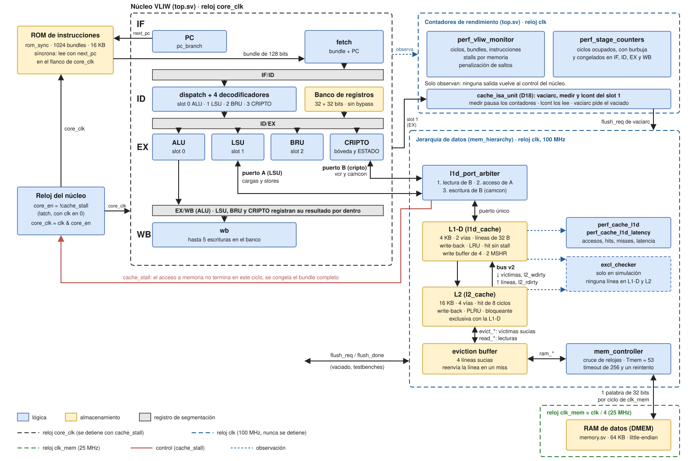

# Organización interna (microarquitectura)

> Curso: CE4301 – Arquitectura de Computadores I, II Semestre 2026  
> Profesor: Dr.-Ing. Jeferson González Gómez  
> Proyecto Grupal 2: jerarquía de memoria y análisis de rendimiento (entrega: 20 de noviembre de 2026)  
> Base: procesador VLIW del Proyecto Grupal 1 (entrega del 14 de octubre de 2026)  
> Equipo: Dylan Guerrero González, José García Izaguirre, Javier Hernández Castillo, Alejandro Vásquez Oviedo, Fabricio Mena Mejia

Cómo se implementa en SystemVerilog el procesador VLIW de [`isa.md`](isa.md) y cómo se le conecta la
jerarquía de memoria del proyecto 2: diagramas, pipeline, ROM de instrucciones, jerarquía de datos,
congelamiento del núcleo, tiempos y contadores. Las políticas de cada caché y su justificación están en
[`memory-hierarchy.md`](memory-hierarchy.md); las señales entre bloques, en
[`memory-interfaces.md`](memory-interfaces.md); las decisiones (D1 a D19), en
[`decisiones-importantes.md`](decisiones-importantes.md), y las pruebas, en
[`simulation.md`](simulation.md).

## 1. Qué cambia respecto al proyecto 1

El proyecto 2 no cambia la ISA ni los tiempos que ve el software. Agrega piezas alrededor del núcleo:

| Pieza | Proyecto 1 | Proyecto 2 |
|:---|:---|:---|
| ISA, bundle y registros | 4 slots fijos de 32 bits, 32 registros | Iguales |
| Pipeline | IF, ID, EX y WB; la memoria de datos se usa en EX | Igual: la caché también se usa en EX, sin etapa MEM (D2) |
| Memoria de instrucciones | Lectura combinacional | ROM síncrona (`rom_sync`) que no cambia ningún tiempo (D1) |
| Memoria de datos | `memory.sv` conectada directo a la LSU y a la cripto, 1 ciclo | L1-D, L2, eviction buffer, controlador y RAM a 25 MHz |
| Stalls | Ninguno | Stall estructural por memoria: se congela el bundle completo |
| Tiempos que ve el software | Regla N+3, saltos de 2 ciclos, bóveda N+1, ESTADO N+3 | Iguales: un stall solo agrega ciclos |
| Medición | Ninguna | Contadores de ciclos, bundles, instrucciones, stalls, etapas y L1-D |

Regla del grupo: los módulos del proyecto 1 (`rtl/` y `tb/`) no se modifican. Lo nuevo está en `rtl-p2/` y
`tb-p2/`, y `rtl-p2/top.sv` lo conecta. El parámetro `MEM_MODE` de `top` elige la memoria de datos:

| `MEM_MODE` | Memoria de datos | Uso |
|:---:|:---|:---|
| 0 (por defecto) | Conexión directa con `DMEM`, como en el proyecto 1 | Regresión: los programas, `make archivo`, `make descifrar` y CE1108 dan los mismos resultados y ciclos que el proyecto 1 |
| 1 | `mem_stall_model`: cada acceso de la LSU tarda `STALL_CYCLES` ciclos más (3 por defecto) | Probar el congelamiento sin cachés |
| 2 | `mem_hierarchy`: la jerarquía completa | El sistema del proyecto 2 |

## 2. Diagramas

### 2.1 Sistema completo



El núcleo (recuadro negro) es el procesador del proyecto 1. La ROM de instrucciones y la RAM de datos
están afuera, y el núcleo se comunica con ellas por buses separados (organización Harvard):

- **Bus de instrucciones:** el núcleo entrega `next_pc` y la ROM devuelve el bundle de 128 bits.
- **Puerto A de datos (LSU):** `re`, `we`, `be`, `addr`, `wdata` y `rdata`, una palabra de 32 bits.
- **Puerto B de datos (cripto):** `re_b`, `we_b`, `addr_b`, `wdata_b` y `rdata_b`, para `vcr` y `camcon`.
- **`cache_stall`:** la jerarquía avisa que el acceso de este ciclo no terminó.

Dentro de la jerarquía los niveles se pasan líneas completas de 32 bytes: el bus versión 2 entre la L1-D
y la L2, `evict_*` y `read_*` entre la L2 y el eviction buffer, y `ram_*` hasta el controlador, que lee y
escribe la RAM una palabra por ciclo de `clk_mem`.

Hay tres relojes:

| Reloj | Frecuencia | Lo usan |
|:---|:---|:---|
| `core_clk` | `clk` sin los ciclos de stall | PC, ROM, IF/ID, ID/EX, EX/WB, banco de registros, LSU, BRU, unidad cripto (bóveda y ESTADO), `trap_pc` y `trap_count` |
| `clk` | 100 MHz, nunca se detiene | Árbitro, L1-D, L2, eviction buffer, controlador y contadores |
| `clk_mem` | `clk / MEM_DIV` = 25 MHz | RAM (`DMEM`) |

Todos los bloques se instancian en `rtl-p2/top.sv`, como se acordó con el profesor; la separación está en
los módulos: `rom_sync` es la ROM, `mem_hierarchy` agrupa la jerarquía de datos y `memory` (instancia
`DMEM`) es la RAM.

### 2.2 Núcleo


Es el diagrama del proyecto 1. En el proyecto 2, la "Memoria de instrucciones" de IF es la ROM síncrona
y la "Memoria de datos" de EX se reemplaza por la jerarquía de la sección 2.1.

Las barras grises son los registros de segmentación. Las 4 unidades de EX reciben sus operandos de
ID/EX y trabajan en paralelo en el mismo ciclo. El conector 1 es la redirección del PC (salto tomado
o excepción) con el vaciado de IF/ID e ID/EX, y el 2 es el permiso que ESTADO da al decodificador
cripto.

## 3. Pipeline

Cuatro etapas, *Fetch → Decode/Dispatch → Execute → Writeback*, con tres registros de segmentación
(`pipeline_if_id`, `pipeline_id_ex` y `pipeline_ex_wb`). Cada bundle de 128 bits avanza completo y
entra uno nuevo por ciclo, salvo durante un stall de memoria. No hay etapa MEM: la memoria de datos (con
la caché, en el proyecto 2) se usa en EX.

| Etapa | Qué hace |
|:---|:---|
| IF | El PC (alineado a 16 bytes, `0x0000` después del reset) elige el bundle de la ROM de instrucciones; IF/ID guarda el bundle y su PC. El PC avanza 16 bytes por ciclo, salvo un salto tomado o una excepción |
| ID | `dispatch` separa los 4 slots y cada decodificador fijo los decodifica en paralelo (slot 0 ALU, 1 LSU, 2 BRU, 3 CRIPTO). `TIPO = 0000000` es NOP y no invoca a la unidad. Se leen los operandos del banco (8 puertos, 2 por slot) y `decoder_crypto` valida los permisos contra ESTADO. Todo se guarda en ID/EX |
| EX | ALU, LSU, BRU y unidad criptográfica operan a la vez sobre los operandos de ID/EX. La LSU accede a la memoria de datos por el puerto A; `vcr` y `camcon`, por el puerto B. Con la jerarquía, los dos puertos llegan a la L1-D por el árbitro. La BRU resuelve los saltos. La bóveda se escribe al final de EX |
| WB | `wb` junta los resultados (hasta 5: ALU, LSU, BRU y el par de la cripto) y los escribe en el banco en el flanco al final de la etapa. ESTADO se actualiza aquí |

La ALU llega a WB por `pipeline_ex_wb`; la LSU, la BRU y la cripto registran su resultado
internamente, con la misma latencia.

**Caché en EX y no en una etapa MEM (D2).** Un hit de la L1-D responde en el mismo ciclo que la memoria
del proyecto 1, así que no cambian la regla N+3, la latencia de las cargas ni el código que generan el
ensamblador y el compilador `balc` de CE1108. Una etapa MEM agregaría un ciclo entre la carga y su uso, y
habría que cambiar el compilador.

**Bóveda escrita en EX.** La bóveda se escribe al final de EX, como la memoria de datos, y no en WB.
Es seguro porque un bundle que llega a EX ya no se puede anular: los saltos y la excepción se
resuelven en EX y solo anulan los bundles de IF e ID, o al propio bundle con la excepción, que
entonces no escribe. La ventaja es que las instrucciones que leen la bóveda (la ronda Feistel, y
`vcr` y `camcon` con la contraseña) también están en EX: una llave cargada con `ell` en el bundle N se
puede usar desde el N+1 (en WB sería desde el N+2), y no hace falta llevar los 64 bits de la llave por
el registro EX/WB.

**Ejemplo.** Desde el ciclo 4 hay un bundle distinto en cada etapa:

| Ciclo | IF | ID | EX | WB |
|---|---|---|---|---|
| 1 | B0 | | | |
| 2 | B1 | B0 | | |
| 3 | B2 | B1 | B0 | |
| 4 | B3 | B2 | B1 | B0 |
| 5 | B4 | B3 | B2 | B1 |

Si B1 es un salto tomado, en el ciclo 4 la BRU lo resuelve en EX: B2 y B3 (en ID e IF) se anulan y en
el ciclo 5 entra a IF el bundle destino. `tb_top` comprueba los 4 bundles a la vez.

## 4. ROM de instrucciones síncrona (D1)

El enunciado pide una ROM síncrona que entregue un bundle por ciclo sin stalls. Una memoria síncrona
entrega el dato un flanco después de recibir la dirección: si la ROM leyera con `pc`, el bundle llegaría
un ciclo tarde, IF necesitaría otra etapa y la penalización de los saltos pasaría de 2 a 3 ciclos.

Por eso `rtl-p2/rom_sync.sv` lee con el **siguiente** PC, que `top` calcula con la misma regla de
`rtl/pc_branch.sv`:

```
next_pc = reset ? 0 : (redirect ? redirect_pc : pc + 16)
always @(posedge core_clk) bundle <= memory[next_pc];
```

En el mismo flanco en que `pc` toma `next_pc`, la ROM toma `memory[next_pc]`. Durante todo el ciclo el
bundle es `memory[pc]`, igual que con la memoria combinacional, así que no cambia ningún tiempo:

| Flanco de `core_clk` | `pc` pasa a | La ROM entrega en el ciclo siguiente |
|:---|:---:|:---|
| Con `reset` en 1 | `0x0000` | El bundle 0 |
| Normal | `pc + 16` | El bundle siguiente |
| Salto tomado o excepción en EX | `redirect_pc` | El bundle destino (o el de `TRAP_VECTOR`) |
| Ninguno (stall) | No cambia | El mismo bundle |

La ROM usa `core_clk`, así que durante un stall se congela junto con el PC. Tiene 1024 bundles (16 KB,
dentro del máximo de 64 KB) y `TRAP_VECTOR` sigue en `0x3FF0`. Mantiene la instancia `IMEM`, el arreglo
`memory` y la carga con `+IMEM=`, así que los testbenches y las herramientas cargan el programa igual que
antes; el programa tiene que estar cargado antes de un flanco con `reset` en 1. Con `ROM_SYNC = 0`
vuelve a la lectura combinacional del proyecto 1. `tb_rom_sync` compara las dos versiones ciclo a ciclo,
con saltos, excepciones y congelamiento.

## 5. Jerarquía de memoria de datos

### 5.1 Cómo entra un acceso

En EX, la LSU y la cripto ponen su acceso en los puertos A y B como en el proyecto 1. `top` agrega dos
señales que la memoria del proyecto 1 no necesitaba, porque leía en todos los ciclos: `mem_re` (carga
válida en EX) y `mem_re_b` (`vcr` o `camcon` válidos y con permiso). Así la caché distingue un acceso de un
ciclo sin acceso. Un bundle anulado por una excepción no llega a la memoria: las dos señales y la escritura
de la LSU se apagan con la falla.

| Bloque | Módulos | Organización |
|:---|:---|:---|
| Árbitro | `l1d_port_arbiter` | Junta los puertos A y B sobre el puerto único de la L1-D (sección 5.3) |
| L1-D | `l1d_cache`, `l1d_arrays`, `l1d_replacement` | 4 KB, 2 vías, 64 conjuntos, líneas de 32 B; write-back y write-allocate; LRU; un hit responde en el mismo ciclo |
| Write buffer | `l1d_write_buffer` | 4 entradas de la L1-D hacia la L2. Si un miss pide una línea que todavía está en el buffer, la L1-D espera a que salga (con la política exclusiva no hay forwarding) |
| MSHR | Dentro de `l1d_cache` | 2: un store que falla no detiene el núcleo mientras haya un MSHR libre; una carga que falla sí lo detiene |
| L2 | `l2_cache`, `l2_arrays`, `l2_replacement` | 16 KB, 4 vías, 128 conjuntos, líneas de 32 B; write-back; pseudo-LRU de árbol; hit en 8 ciclos; bloqueante (una petición a la vez) |
| Eviction buffer | `eviction_buffer` | 4 líneas sucias de la L2 hacia la RAM; si la L2 pide una línea que está ahí, la reenvía sin ir a la RAM |
| Controlador | `mem_controller` | Genera `clk_mem`, cruza los dominios de reloj con handshake y 2 flip-flops, Tmem = 25 + 7 × 4 = 53 ciclos por línea, timeout de 256 ciclos con un reintento |
| RAM | `memory` del proyecto 1 (instancia `DMEM`) | 64 KB, *little-endian*, con `clk_mem` |

Las direcciones físicas son de 16 bits (64 KB):

| Campo | L1-D | L2 |
|:---|:---:|:---:|
| Etiqueta | [15:11] (5 bits) | [15:12] (4 bits) |
| Conjunto | [10:5] (64) | [11:5] (128) |
| Palabra dentro de la línea | [4:2] | [4:2] |
| Byte dentro de la palabra | [1:0] | [1:0] |

Los tamaños, las políticas y las latencias están en `rtl-p2/cache_defs.sv` y los módulos los toman como
parámetros.

### 5.2 Política exclusiva (D3, crédito extra)

Una línea está en la L1-D o en la L2, nunca en las dos, así que la capacidad útil es 4 + 16 = 20 KB (con
NINE serían 16 KB).

- Si la L1-D falla y la L2 acierta, la L2 le **mueve** la línea y la invalida; `l2_rdirty` dice si estaba
  sucia, para que la L1-D la siga tratando como sucia.
- Toda víctima de la L1-D, limpia o sucia, baja a la L2 por el write buffer; `l2_wdirty` dice si está
  sucia.
- Una línea que llega de la RAM va directo a la L1-D y no se queda en la L2.
- Las víctimas sucias de la L2 van a la RAM por el eviction buffer; las limpias se descartan, porque la RAM
  ya tiene ese valor.

`rtl-p2/excl_checker.sv` (solo en simulación) revisa en cada ciclo que ninguna línea válida de la L1-D esté
también en la L2; `tb_mem_hierarchy` y `tb_port_b` exigen 0 violaciones. NINE sigue disponible como
parámetro (`INCL_NINE` en `cache_defs.sv`).

### 5.3 Puerto B (cripto) por la L1-D (D17)

Con write-back, la copia más nueva de una palabra puede estar sucia en la L1-D, así que `vcr` y `camcon`
no pueden leer la RAM directamente: entran a la L1-D como un acceso más. Como la L1-D tiene un solo
puerto, `l1d_port_arbiter` atiende los accesos de un bundle en tres fases:

1. Lectura de B (`vcr` o `camcon`).
2. Acceso de A (carga o store).
3. Escritura de B (`camcon` escribe la palabra rotada).

Ese orden da el mismo resultado que el proyecto 1, donde el bundle completo lee antes de escribir y, si A y
B escriben la misma palabra, gana B. Una fase que ya terminó no se repite durante el stall: cada store
llega una sola vez a la L1-D y `camcon` rota la palabra una sola vez. Costo si todos los accesos aciertan
(medido en `tb_mem_hierarchy`):

| Bundle | Ciclos de stall |
|:---|:---:|
| Solo A, o solo `vcr` | 0 |
| A y `vcr`, o solo `camcon` | 1 |
| A y `camcon` | 2 |

Si una fase falla, se suma la latencia de su miss.

## 6. Congelamiento del núcleo

Un acceso que no termina en un ciclo detiene el **bundle completo**, no solo el slot de la LSU, como pide
el enunciado: los 4 slots de un bundle avanzan juntos porque el compilador los calendarizó para el mismo
ciclo.

**Cómo se detiene.** Los módulos del proyecto 1 no tienen una entrada de habilitación y no se pueden
modificar, así que se detiene su reloj. En `top`:

```
always @(*) if (!clk) core_en = !cache_stall;   // latch: se toma con clk en 0
assign core_clk = clk & core_en;
```

`core_en` se toma mientras `clk` está en 0, así que un cambio de `cache_stall` con `clk` en 1 no produce
flancos falsos. `cache_stall` depende solo del acceso (que sale de ID/EX) y de registros de la jerarquía,
así que está estable antes del flanco de bajada. Con `MEM_MODE = 0`, `cache_stall` es 0 y `core_clk` es
igual a `clk`.

**Qué pasa durante el stall.** Sin flancos de `core_clk`, el PC, la ROM, los registros de segmentación,
el banco y las unidades mantienen su valor: los 4 bundles se quedan en sus etapas y el de EX mantiene su
acceso en los puertos. La jerarquía sigue trabajando con `clk`. Cuando el dato está listo, `cache_stall`
baja y en el flanco siguiente todo avanza como en el proyecto 1. Ejemplo con una carga en B2 que falla en
la L1-D y acierta en la L2 (8 ciclos de stall):

| Ciclo | IF | ID | EX | WB | `cache_stall` |
|:---|:---:|:---:|:---|:---:|:---:|
| 1 | B4 | B3 | B2: la carga falla en la L1-D | B1 | 1 |
| 2 a 8 | B4 | B3 | B2: espera la línea de la L2 | B1 | 1 |
| 9 | B4 | B3 | B2: el dato está listo | B1 | 0 |
| 10 | B5 | B4 | B3 | B2 | 0 |

B1 escribe el banco una sola vez, en el flanco del final del ciclo 9. El software no cambia: la regla N+3
cuenta bundles, no ciclos, y el resultado es el mismo con más ciclos. `tb_pipeline_stall` comprueba que el
PC, IF/ID e ID/EX no se mueven durante cada stall y que las escrituras son las mismas, en el mismo orden,
que en el procesador sin stalls.

## 7. Tiempos

Ciclos de stall de un acceso con la jerarquía completa (medidos en `tb_mem_hierarchy`):

| Acceso | Ciclos de stall | Enunciado |
|:---|:---:|:---:|
| Hit en la L1-D (carga, store o `vcr`) | 0 | 0 |
| Store que falla, con un MSHR libre | 0 | |
| Carga que falla en la L1-D y acierta en la L2 | 8 | +8 |
| Carga que falla en la L1-D y en la L2 | 64 = 8 + 53 + 3 | +8 + Tmem |

Los 3 ciclos de más son el paso por el eviction buffer y la sincronización de la respuesta entre
`clk_mem` y `clk`; son iguales en todas las fases de `clk_mem`. Tmem depende de `MEM_DIV`: 39 ciclos a
50 MHz (`MEM_DIV = 2`), 53 a 25 MHz (4) y 60 a 20 MHz (5), medidos en `tb_mem_controller`.

Efecto en un programa completo: `make archivo` (cifrar y descifrar con `cifrar_archivo.asm` y
`descifrar_archivo.asm`) da el mismo `cifrado.bin` en los dos modos, con más ciclos en el modo 2:

| Archivo | Tamaño | Modo 0 (proyecto 1) | Modo 2 (jerarquía) | Vaciado después de cifrar |
|:---|---:|---:|---:|---:|
| `mensaje.txt` | 386 B | 989 | 1886 | 1105 |
| `imagen.bmp` | 9270 B | 23189 | 41814 | 16631 |
| `datos.bin` | 1000 B | 2509 | 4622 | 2112 |

Las columnas de los modos 0 y 2 son los ciclos del programa de cifrado; el vaciado se cuenta aparte.

## 8. Vaciado de la caché (D16)

Con write-back, la RAM no tiene los últimos valores hasta que las líneas sucias bajan. Antes de leer
`DUT.DMEM.mem`, un testbench pone `flush_req = 1` y espera `flush_done`:

1. La L1-D manda sus líneas sucias a la L2 (incluidas las del write buffer).
2. Cuando la L1-D termina, la L2 recibe su pedido de vaciado y manda sus líneas sucias al eviction buffer.
   Empieza después porque, mientras vacía, no atiende peticiones, y la L1-D necesita mandarle sus víctimas.
3. `flush_done` sube cuando la L2 terminó y el eviction buffer y el controlador quedaron vacíos.

`flush_done` se mantiene mientras `flush_req` siga en 1. En los modos 0 y 1 no hay nada que vaciar y
`flush_done` sigue a `flush_req`. Con `imagen.bmp` (290 líneas) el vaciado tarda 16631 ciclos, unos 57 por
línea sucia. El peor caso, con las 640 líneas de las dos cachés sucias, ronda los 37000 ciclos, así que
los testbenches de `tests/rtl/` esperan hasta 100000 (`+FLUSH_MAXCYCLES` lo cambia).

## 9. Contadores de rendimiento

Todos usan `clk`, que no se detiene, así que cuentan también los ciclos de stall. Solo observan: ninguna
salida vuelve al control del núcleo ni de la caché.

| Módulo | Dónde | Qué mide |
|:---|:---|:---|
| `perf_vliw_monitor` (con `perf_slot_mask`, `perf_pipeline_monitor` y `perf_counters`) | `top` | Ciclos, bundles e instrucciones (sin NOP) ejecutados, ciclos de stall por memoria y ciclos perdidos por saltos |
| `perf_stage_counters` | `top` | Por etapa (IF, ID, EX y WB): ciclos ocupados, con burbuja y congelados |
| `perf_cache_l1d` | `mem_hierarchy` | Eventos de la L1-D: lecturas y escrituras con hit y miss, llenados, víctimas limpias y sucias, MSHR, write buffer y riesgos RAW |
| `perf_cache_l1d_latency` | `mem_hierarchy` | Ciclos de servicio de cada acceso a la L1-D por tipo (lectura o escritura, hit o miss), para la AMAT |

`perf_measure_enable` pausa la cuenta sin borrarla y `PERF_ENABLE = 0` quita los contadores al elaborar.
La L2 entrega diez eventos `ev_l2_*` de un ciclo y `rtl-p2/perf_memory.sv` mide la memoria principal;
estos contadores todavía no están conectados en `mem_hierarchy` (#26).

## 10. Riesgos y excepción de privilegio

- **Sin forwarding ni scoreboarding.** El banco no tiene bypass: el valor que escribe el bundle N se lee
  desde el N+3. La calendarización la hace el software, y `tools/assembler.py` rechaza los programas que
  no la cumplen. El único stall es el estructural de la memoria (sección 6); el hardware sigue sin
  detectar riesgos de datos.
- **Conflictos estructurales.** En el núcleo cada slot tiene sus puertos del banco (2 de lectura; 1 de
  escritura, 2 para la cripto) y la memoria tiene un puerto para la LSU y otro para la cripto. Con la
  jerarquía, los dos puertos comparten el puerto único de la L1-D: el árbitro los atiende uno después del
  otro y el núcleo espera (sección 5.3). Que dos unidades escriban el mismo registro es un error del
  software: `wb` lo señala con `conflict` y gana CRIPTO > BRU > LSU > ALU.
- **Saltos sin delay slots.** Un salto tomado anula los 2 bundles de IF e ID (2 ciclos de
  penalización); uno no tomado no cuesta nada. La ROM síncrona no lo cambia.
- **Excepción de privilegio.** Si una instrucción cripto no tiene permiso (`fsl`, `fsli`, `ell` y
  `camcon` necesitan AUTH = 1; `setpwd`, INIT = 1), al llegar a EX se anula su bundle completo y los 2
  siguientes, y el PC salta a `TRAP_VECTOR` = `0x3FF0`, el último bundle de la memoria de
  instrucciones. `trap_pc` y `trap_count` guardan el PC culpable y la cantidad de excepciones (solo
  para observación). Como ESTADO se escribe en WB y se valida en ID, después de `vcr` la instrucción
  que necesita AUTH = 1 va 3 bundles después.

## 11. Componentes

| Componente | Organización |
|:---|:---|
| Banco de registros | 32 × 32 bits, x0 = 0, 8 lecturas combinacionales y 5 escrituras, reset síncrono |
| ROM de instrucciones | 1024 bundles de 128 bits (16 KB), síncrona, leída con el siguiente PC; carga con `$readmemh` (`+IMEM`); `0x3FF0` es `TRAP_VECTOR` |
| L1-D | 4 KB, 2 vías, líneas de 32 B, write-back, write-allocate, LRU, write buffer de 4 entradas y 2 MSHR |
| L2 | 16 KB, 4 vías, líneas de 32 B, write-back, pseudo-LRU, hit de 8 ciclos, exclusiva con la L1-D |
| Eviction buffer | 4 líneas (4 a 16 con `EB_DEPTH`) |
| RAM de datos | 64 KB, por byte, *little-endian*, escritura con byte enables, reloj `clk_mem`. Espacio separado de la ROM |
| Bóveda de llaves | 4 llaves de 128 bits (4 subllaves de 32) y la contraseña, dentro de `crypto_unit`. Solo la lee la ronda Feistel; no tiene camino a registros ni a memoria. El reset la borra |
| ESTADO | AUTH e INIT, dentro de `crypto_unit`; no lo lee ninguna instrucción |
| Parámetros | `rtl/isa_defs.sv`: `NUM_SLOTS`, `SLOT_W`, `BUNDLE_W`, `BUNDLE_BYTES`, `IMEM_BUNDLES`, `DMEM_BYTES` y `TRAP_VECTOR`. `rtl-p2/cache_defs.sv`: tamaños, políticas y latencias de la jerarquía |

Parámetros de `top`:

| Parámetro | Por defecto | Qué hace |
|:---|:---:|:---|
| `MEM_MODE` | 0 | Memoria de datos (sección 1) |
| `STALL_CYCLES` | 3 | Solo con `MEM_MODE = 1`: ciclos de más por acceso de la LSU |
| `L2_MODEL` | 0 | Solo con `MEM_MODE = 2`: 1 cambia la L2, el eviction buffer y el controlador por `l2_model`, una L2 de prueba que siempre acierta en 8 ciclos |
| `MEM_DIV` | 4 | Solo con `MEM_MODE = 2`: `clk_mem = clk / MEM_DIV` (2 = 50 MHz, 4 = 25 MHz, 5 = 20 MHz) |
| `ROM_SYNC` | 1 | 0 = memoria de instrucciones combinacional, como en el proyecto 1 |
| `PERF_ENABLE` | 1 | 0 = sin contadores |

`python3 tools/run_program.py --mem-mode 2` ejecuta un programa con la jerarquía completa, y
`make test-memory-modes` corre los mismos programas en los modos 0 y 2 y compara los registros y la
memoria después del vaciado.

## 12. Módulos SystemVerilog

| Bloque | Archivos |
|---|---|
| IF | `rtl/pc_branch.sv`, `rtl-p2/rom_sync.sv`, `rtl/fetch.sv`, `rtl/pipeline_if_id.sv` |
| ID | `rtl/dispatch.sv`, `rtl/decoder_alu.sv`, `rtl/decoder_lsu.sv`, `rtl/decoder_bru.sv`, `rtl/decoder_crypto.sv`, `rtl/regfile.sv`, `rtl/pipeline_id_ex.sv` |
| EX | `rtl/alu.sv`, `rtl/lsu.sv`, `rtl/bru.sv`, `rtl/crypto_unit.sv`, `rtl/key_vault.sv` |
| WB | `rtl/pipeline_ex_wb.sv`, `rtl/wb.sv` |
| Jerarquía de datos | `rtl-p2/mem_hierarchy.sv`, `rtl-p2/l1d_port_arbiter.sv`, `rtl-p2/l1d_cache.sv`, `rtl-p2/l1d_arrays.sv`, `rtl-p2/l1d_replacement.sv`, `rtl-p2/l1d_write_buffer.sv`, `rtl-p2/l2_cache.sv`, `rtl-p2/l2_arrays.sv`, `rtl-p2/l2_replacement.sv`, `rtl-p2/eviction_buffer.sv`, `rtl-p2/mem_controller.sv` y `rtl/memory.sv` (RAM) |
| Modelos de prueba | `rtl-p2/mem_stall_model.sv` (modo 1), `rtl-p2/l2_model.sv` (`L2_MODEL = 1`), `rtl-p2/excl_checker.sv` (solo simulación) |
| Contadores | `rtl-p2/perf_vliw_monitor.sv`, `rtl-p2/perf_slot_mask.sv`, `rtl-p2/perf_pipeline_monitor.sv`, `rtl-p2/perf_counters.sv`, `rtl-p2/perf_stage_counters.sv`, `rtl-p2/perf_cache_l1d.sv`, `rtl-p2/perf_cache_l1d_latency.sv`, `rtl-p2/perf_memory.sv` |
| Integración | `rtl-p2/top.sv` (conexiones, flush, excepción, reloj del núcleo y `MEM_MODE`), `rtl/isa_defs.sv` y `rtl-p2/cache_defs.sv` (códigos y parámetros) |
| Pruebas | Un testbench por módulo en `tb/` y `tb-p2/`, más los de sistema: `tb_top`, `tb_pipeline_integracion` y `tb_pipeline_cripto` (proyecto 1); `tb_pipeline_stall`, `tb_rom_sync`, `tb_port_b` y `tb_mem_hierarchy` (proyecto 2). Detalle en [simulation.md](simulation.md) |

`rtl-p2/decoder_cache_isa.sv` y `rtl-p2/cache_isa_unit.sv` implementan las instrucciones opcionales
`vaciarc`, `medir` y `lcont` (D18); todavía no están conectadas en `top`.
