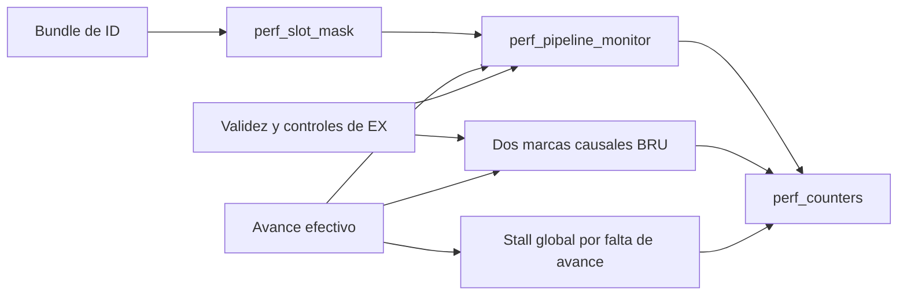

# D4-B1: módulo RTL independiente de métricas VLIW

## Objetivo, rama y alcance

`rtl-p2/perf_vliw_monitor.sv` compone los bloques de métricas aprobados y el
seguimiento causal mínimo de recuperación BRU. Recibe todas sus entradas por
puertos normales y no escribe ningún estado del procesador.

Rama `feat/7-d4b1-modulo-metricas`, creada desde `origin/develop` después de
fetch, en `0dfac60f44ff19919825e52ee41281e7c5257765`, incorporación de D5-A.
Origin es `fabrimena/Proyecto2_Arquitectura1`; el árbol y el índice estaban
limpios. HEAD permanece intacto. Solo se crean el RTL, su testbench y este documento.

**D4-B1** entrega un módulo independiente validado mediante conexiones externas.
**D4-B2** conectará ese módulo dentro de top, previa coordinación con Fabricio.
Top permanece sin modificar y sin una instancia interna de este módulo.
No se implementa ni valida una jerarquía L1-D/L2 integrada.

## Contratos revisados y arquitectura

Se contrastaron los tres módulos perf existentes, top, mem_stall_model, los
bancos D3/D4-A/D5-A y los documentos performance-analysis, D3, D4-A, D5-A y
memory-interfaces. La interfaz conserva los contratos efectivos de sus flancos.



Se instancia exactamente un `perf_slot_mask`, un `perf_pipeline_monitor` y un
`perf_counters`. No se copian tablas ISA, registros de metadatos ni acumuladores.
El único estado nuevo son dos bits que identifican posiciones jóvenes descartadas.
El RTL no contiene jerarquías del procesador, retardos, archivos, plusargs,
VCD ni funciones exclusivas de simulación. No genera ni modifica relojes.

## Interfaz de entrada

| Puerto | Ancho | Contrato antes del flanco de clk |
|---|---:|---|
| clk | 1 | Reloj general sin detener durante stalls. |
| reset | 1 | Reset síncrono prioritario común a métricas y marcas. |
| measure_enable | 1 | Habilita acumulación sin detener el seguimiento. |
| core_advance | 1 | Decisión efectiva de avance global que se aplicará en este flanco. |
| id_valid | 1 | Validez del bundle presente en ID. |
| id_bundle | 128 | Bundle de ID, cuatro slots fijos del ISA. |
| ex_valid | 1 | Validez real del bundle presente en EX. |
| ex_branch_taken | 1 | Condición BRU efectiva de salto tomado; no redirect genérico. |
| ex_exception | 1 | Excepción del bundle actual de EX, con prioridad sobre BRU. |

El productor debe presentar un flujo ID–EX–WB coherente, en orden y con avance
conjunto. La validez EX real debe corresponder a la validez que D2 transporta
desde ID; el módulo no resincroniza entradas incoherentes ni corrige el pipeline.
Las entradas deben estar estables antes del flanco y respetar su tiempo de captura.
No se garantiza inicialización de registros antes del primer reset.

## Salidas y uso de diagnósticos

| Puerto | Ancho | Semántica |
|---|---:|---|
| cycle_count | 64 | Flancos medidos de clk, incluidos stalls. |
| bundle_count | 64 | Bundles válidos consumidos en WB dentro de ventana. |
| instruction_count | 64 | Operaciones reconocidas no NOP de esos bundles. |
| memory_stall_count | 64 | Flancos medidos congelados por memoria bajo el supuesto global. |
| branch_penalty_count | 64 | Oportunidades EX perdidas por BRU dentro de ventana. |
| bundle_complete | 1 | Evento combinacional del WB anterior al flanco, independiente de medición. |
| branch_recovery | 1 | Oportunidad causal EX consumible en este avance, no evento de salto. |
| memory_stall | 1 | Congelamiento aplicado: `!reset && !core_advance`. |
| wb_non_nop_mask | 4 | Máscara alineada con el WB que se puede consumir. |

Los cuatro diagnósticos permiten comprobar fechas y máscaras sin acceder a
registros internos. Después de NBA bundle_complete/máscara describen el nuevo
WB elegible para el próximo flanco; no una segunda finalización en el mismo.
Las sumas son las de A–C, unsigned y módulo 2^64. IPC sigue fuera del hardware:
instrucciones/ciclos con conversión real; cero ciclos significa NO DEFINIDO.

## Clasificación ISA y finalización ID–EX–WB

D1 recibe id_bundle; reconoce las 34 operaciones por tipo/ID y slot. Un destino
x0 no elimina una operación, un store no necesita escribir GPR y CRIPTO aporta
un bit aunque escriba un par. Los reservados siguen excluidos según D1; esto
no convierte en NOP el fallback ADD de codificaciones ALU reservadas del hardware.
La instrumentación requiere programas que respeten la ISA y no valida operandos
ni permisos criptográficos a partir de la máscara.

D2 recibe esa máscara, validez ID, clk general y core_advance. Transporta validez,
máscaras y anulaciones. Un NOP válido completa con máscara cero; una burbuja no.
La excepción válida anula EX y los dos jóvenes; el WB anterior puede completar.
La BRU válida sin excepción conserva su bundle y descarta los dos jóvenes.
No se infieren finalizaciones ni operaciones de wb_we.

## Recuperación BRU causal

Se forman `effective_exception = ex_valid && ex_exception` y
`effective_branch = ex_valid && ex_branch_taken && !ex_exception`.
Se acepta BRU solo con `!reset && core_advance && effective_branch`.

En el flanco R de aceptación se marcan dos posiciones:
`discarded_id` identifica el hueco de IF/ID y `discarded_ex` el de EX.
En el siguiente avance, la primera marca pasa a EX; después ambas se vacían.
No se usa un acumulador fijo de dos ni se convierte branch_flush directamente
en penalización. La señal de recuperación exige simultáneamente marca EX,
`!ex_valid`, avance efectivo y ausencia de reset.

| Flanco/avance | EX antes del flanco | Recuperación consumida |
|---|---|---:|
| R | Bundle de salto válido | 0 |
| Siguiente avance | Primer hueco causal, WB del salto aún puede completar | 1 |
| Segundo avance siguiente | Segundo hueco causal | 1 |
| Tercer avance siguiente | Bundle destino válido | 0 |

Con avance continuo son R+1/R+2 en ciclos absolutos. Sin avance las marcas no
se desplazan, no se crean aceptaciones repetidas y recuperación es cero.
Un NOP válido no se convierte en hueco por tener instrucción cero. Una excepción
puede vaciar etapas, pero nunca crea marcas de BRU. La ventana no controla marcas.

## Stall global, prioridades y alcance

`memory_stall` se deriva del avance efectivo, no de cache_stall leído después
de NBA. El supuesto explícito es que **toda falta de avance se debe a memoria**
y congela todas las etapas. No es compatible automáticamente con espera por otras
causas, avance parcial, ejecución bajo miss o pipelines diferentes.

Los contadores siguen usando clk; en memoria suben solo ciclos y memoria.
Con avance pueden sumar WB y recuperación simultáneamente. La prioridad
memoria sobre BRU permanece dentro del contador existente. Los diagnósticos
normales del wrapper son mutuamente excluyentes por core_advance; las pruebas
unitarias de A–C siguen verificando la prioridad cuando ambos indicadores se presentan.

D5-A mostró que una LSU válida en EX no puede coincidir con el hueco EX inválido
de recuperación en este modelo. La retención de marcas no cero se prueba aquí
con estímulos abstractos separados, no se presenta como suceso observado en top.

## Ventana y reset

measure_enable controla únicamente el puerto de habilitación de perf_counters.
D1/D2 y las marcas BRU siguen su flujo aunque no se mida. Pausar conserva cinco
acumulados; reanudar no recupera eventos o huecos que ya transcurrieron fuera de ventana.
Reset borra marcas, metadatos y cinco contadores incluso con core_advance=0.
Los eventos combinacionales completos/memoria/recuperación se inhiben por reset.

Este módulo no cambia efectos arquitectónicos. Se reproduce la limitación de
D5-A: en top, reset libera stall y puede habilitar un store pendiente porque
`m_we=we && !stall` no está inhibida por reset y DMEM no tiene reset. El caso
real almacena 77 en DMEM[0] durante reset, mientras métricas y metadatos se borran.
No se afirma cancelación atómica de memoria ni se interviene sobre m_we.

## Testbench: programa reducido, referencias y pasividad

La prueba usa tres configuraciones reales: modo0, modo1/espera1, modo1/espera4.
Cada una tiene una instancia del wrapper y un top SHADOW de igual configuración,
programa, reloj, reset y horizonte, sin instrumentación. Se comparan secuencias
de puertos GPR, ambos puertos DMEM, redirecciones, reloj del núcleo, 32 GPR y
estado público. No se inspecciona la bóveda ni se utiliza force.

El oráculo independiente usa tablas de máscara/control/destino, PC predicho,
series dinámicas y fecha WB n+3 en avances efectivos. Predice WAIT esperas desde
la LSU conocida y comprueba core_en real. Cuenta expectativas por flanco, sin
leer acumulados o eventos del wrapper como fuente. No replica unidades ISA.
El primer flanco divergente conserva PRE/POST y termina con código no cero.

El programa es más corto que D5-A y tiene expectativas propias:

| Bundles | Escenario |
|---|---|
| 0–2 y NOP de destino16 | ALU y NOP válidos. |
| 4–8 | Bundle ALU+store+condicional falso, cargas palabra/byte, byte store y consumo N+3. |
| 9–12 | Tres decrementos; store con BRU hacia atrás, dos tomados y salida no tomada. |
| 13–21 | Saltos con/sin LSU, jóvenes anulados, NOP destino y enlaces. |
| 22–24 | ALU/store/jump/FSL no autorizado: excepción gana, culpable y jóvenes anulados. |
| 1023 | Manejador x30=99 y salto a sí mismo; observar su primera recuperación completa. |

Hay ocho accesos LSU aceptados; no se incluyen LSU anuladas. Se verifican x2=0,
x6/x7=77, x8=78, enlace x11=304, x9=9 y x13=13 del WB anterior a excepción.
DMEM[0]=77, DMEM[4]=0x4D00, último store del bucle en DMEM[8]=0 y sentinelas
intactos en las posiciones de stores anulados. Trap: PC352, una excepción y x30=99.
No se impone la tabla72/91/148 de D5-A a este programa diferente.

## Resultados medidos

Punto equivalente: segundo hueco EX del primer salto del manejador, con todos
los efectos anteriores consumidos. Se capturan estados antes de comparar modos;
los núcleos siguen corriendo y los observadores cierran su ventana, sin detenerlos.

| Configuración | Ciclos reales/medidos, ventana completa | Avances | Bundles | Instrucciones | Memoria | BRU | Saltos | Excepciones |
|---|---:|---:|---:|---:|---:|---:|---:|---:|
| MEM_MODE=0 | 42 | 42 | 27 | 25 | 0 | 10 | 5 | 1 |
| MEM_MODE=1, WAIT=1 | 50 | 42 | 27 | 25 | 8 | 10 | 5 | 1 |
| MEM_MODE=1, WAIT=4 | 74 | 42 | 27 | 25 | 32 | 10 | 5 | 1 |

Se prueban cuatro políticas: ventana completa, inicio en ciclo real 8, pausa en
las esperas del primer acceso y en el primer hueco de cada recuperación, y
ventana vacía. Para la tercera política quedan cinco penalizaciones BRU; para
ventana vacía todos los acumulados son cero sin detener el seguimiento.
Un inicio por ciclo absoluto abarca distinto progreso entre configuraciones;
las expectativas se verifican individualmente, no se exige igualdad incorrecta.

Cada ejecución completa produce 25 efectos ordenados por avance. Se comparan
las secuencias, no solo el estado final. Se compara DMEM completa con cada
sombra y entre modos en puntos equivalentes:20 comparaciones de 16384 palabras,
65536 bytes cada una, por igualdad real y sin sustituirla por un hash.

## Estímulos abstractos y resets

Además de los procesadores reales se ejercita otra instancia normal del wrapper,
con entradas de un pipeline abstracto coherente, mediante 27 pasos de expectativas
numéricas explícitas. No es una segunda implementación del wrapper.

Se acepta un salto, se congela cuatro flancos con ambas marcas pendientes, se
consume la primera, se congela tres flancos más y se consume la segunda. Se
conservan las finalizaciones previas y no se cuentan las esperas como BRU.
También se verifica reset sin avance con marcas pendientes, controles sobre EX
inválido, raw BRU+excepción simultáneos y finalización de cuatro slots después
de pausar la medición. Esta es evidencia de la propiedad del módulo, no de un
stall LSU que top no puede producir durante sus huecos EX.

Los casos reales adicionales aplican reset con un store pendiente y con una
recuperación BRU pendiente. Las nuevas épocas no recuperan métricas antiguas.
La publicación de memoria durante reset se observa y documenta por separado.

## Controles negativos

Las nueve mutaciones alteran únicamente las lecturas diagnósticas del testbench;
no cambian puertos de CPU, entradas del wrapper ni ningún RTL del DUT. Demuestran
sensibilidad del oráculo, no nueve defectos del módulo correcto. Todas terminan
con VVP 1 por la aserción prevista:

| Variante | Defecto simulado en diagnóstico | Primer fallo caso/config/ciclo |
|---|---|---|
| 1 | Finalización retrasada un flanco | 1/0/4 |
| 2 | Finalización espuria durante memoria | 1/1/7 |
| 3 | Máscara WB incorrecta | 1/0/4 |
| 4 | Penalización adelantada al evento BRU | 1/0/15 |
| 5 | Recuperación omitida | 1/0/16 |
| 6 | Stall omitido | 1/1/7 |
| 7 | Lectura de acumulado incluye ciclo durante pausa | 2/0/1 |
| 8 | Excepción clasificada como BRU | 1/0/37 |
| 9 | Finalización omitida | 1/0/4 |

Las comparaciones por fecha detectan también un evento adelantado, duplicado o
perdido aunque no se haya creado una variante separada para cada combinación.
No se debilitaron aserciones ni fue necesario corregir archivos protegidos.

## Herramientas, regresiones y reproducción

Icarus Verilog/VVP 12.0, flags oficiales. El wrapper compila como módulo superior
con solo sus tres dependencias, sin top ni testbench. No hay advertencias de esa
compilación. No se realizó síntesis física. Verilator y Yosys no estaban disponibles;
no se agregaron dependencias ni se presenta compilación como síntesis/lint.

Normal y con VCD: **42188 verificaciones PASS**, make 0. Primera ejecución de
desarrollo también pasó; no se encontraron divergencias nuevas en componentes protegidos.

| Comando | Antes / después | Código antes / después |
|---|---|---|
| make tb_perf_counters | 292 / 292 | 0 / 0 |
| make tb_perf_slot_mask | 4299 / 4299 | 0 / 0 |
| make tb_perf_pipeline_monitor | 9981 / 9981 | 0 / 0 |
| make tb_perf_top_d3 | 13717 / 13717 | 0 / 0 |
| make tb_perf_branch_d4a | 12573 / 12573 | 0 / 0 |
| make tb_perf_stall_d5a | 72538 / 72538 | 0 / 0 |
| make tb_pipeline_stall | 50 / 50 | 0 / 0 |
| make tb_l1d_replacement | 17 / 17 | 0 / 0 |
| make tb_l1d_write_buffer | 14248 / 14248 | 0 / 0 |
| make tb_l1d_cache | 79 / 79 | 0 / 0 |
| make sim | 31 / 32 PASS; cero FAIL/NO-COMPILA/SIN-CHEQUEO | 0 / 0 |
| make test-assembler | 44 / 44 métodos | 0 / 0 |
| make test-programs | 14 / 14 métodos | 0 / 0 |

Todas las pruebas se ejecutan en copia aislada externa. El Makefile descubre
el nuevo testbench sin cambios. En una copia que incluya estos tres archivos:

```bash
make tb_perf_vliw_monitor_d4b1
make tb_perf_vliw_monitor_d4b1 PLUSARGS=+vcd
# Negativo separado: debe terminar con error.
make tb_perf_vliw_monitor_d4b1 PLUSARGS=+mutacion=1
```

Ejecutar también los trece comandos de la tabla. Los CSV por configuración
conservan PRE/POST (460/524/716 filas, 29 campos), máscara, evento, causa de tiempo,
cinco acumulados y cinco expectativas posteriores al flanco. PRE aún contiene
acumulados obtenidos anteriores; POST ya contiene NBA. El campo avances describe
el progreso esperado incluyendo el flanco indicado, y fecha/serie identifican WB.
Reset inicia una nueva época con ciclo cero. CSV de efectos conservan orden y datos.
El VCD opcional selecciona control y métricas públicas; no vuelca VAULT.
Logs, código compilado, ondas, manifiestos, diff e informe A–Z se conservan fuera
de ambos repositorios, nunca se ejecuta clean sobre el original.

## Conexiones propuestas para D4-B2

Esta tabla es propuesta de integración para revisar, no un cambio de top:

| Puerto del wrapper | Fuente real propuesta | Etapa/semántica y muestreo | Reset y límites |
|---|---|---|---|
| clk | top.clk | Reloj general, posedge | No sustituir por core_clk. |
| reset | top.reset | Síncrono común | Confirmar recepción del reset por núcleo y política de stores pendientes. |
| measure_enable | Todavía no existe fuente acordada en top | Control externo de ventana, estable PRE | Decidir interfaz con Fabricio; no reutilizar reset para pausar. |
| core_advance | top.core_en | Avance global aplicado al próximo posedge, tomado con clk bajo | No usar cache_stall POST; revisar si aparecen causas ajenas a memoria. |
| id_valid | top.id_valid | Validez IF/ID en ID, PRE | Reset debe vaciar el mismo flujo real que observa D2. |
| id_bundle | top.id_bundle | Bundle 128 de ID, PRE | Debe acompañar a id_valid; máscara no reemplaza validez. |
| ex_valid | top.id_ex_valid | Validez ID/EX en EX, PRE | Debe estar alineada con el transporte de D2. |
| ex_branch_taken | top.branch_flush | Salto BRU efectivo en EX, PRE | Wrapper exige EX válido y suprime ante excepción; no usar redirect. |
| ex_exception | top.crypto_fault | Excepción del bundle EX, PRE | No clasificar como BRU; el productor determina permisos. |

Los diagnósticos se consumen PRE y los acumulados se leen POST. Para pruebas se
puede acordar una ruta interna estable de observación de la instancia o exponer
los acumulados mediante puertos de depuración; ambas opciones requieren revisar
con Fabricio nombres y compatibilidad. D4-B1 no modifica puertos públicos de top
ni decide unilateralmente una interfaz de software, CSR o señal de arranque.

## Limitaciones y coordinación pendiente

Cualquier modificación de top, registros, reloj o memoria para D4-B2 requiere
coordinación. Confirmar avance conjunto, reset, ventana, interfaces de observación,
prioridad de excepción y cronología de entrada. Las pruebas no certifican todos
los programas ni una secuencia criptográfica autorizada completa con el wrapper;
la regresión D5-A conserva su cobertura previa de Feistel/camcon.

Si la jerarquía introduce otras causas de detención, requerirá separar causas
reales en la interfaz en lugar de atribuir toda falta de avance a memoria.
Si permite avance parcial o más de un bundle en vuelo fuera de este flujo,
revisar D2, máscaras, finalizaciones y marcas causales antes de reutilizar el módulo.
Los PASS de caché son regresiones unitarias existentes, no integración del wrapper
con L1/L2 ni AMAT real. No se presume MEM_MODE=2 funcional.
